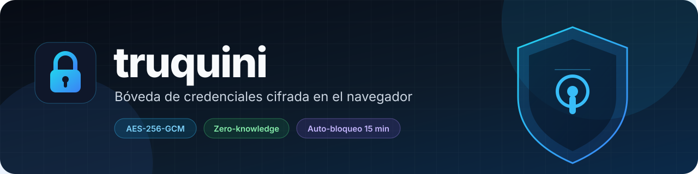
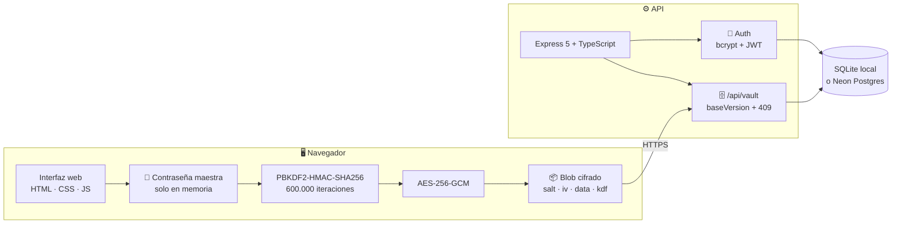
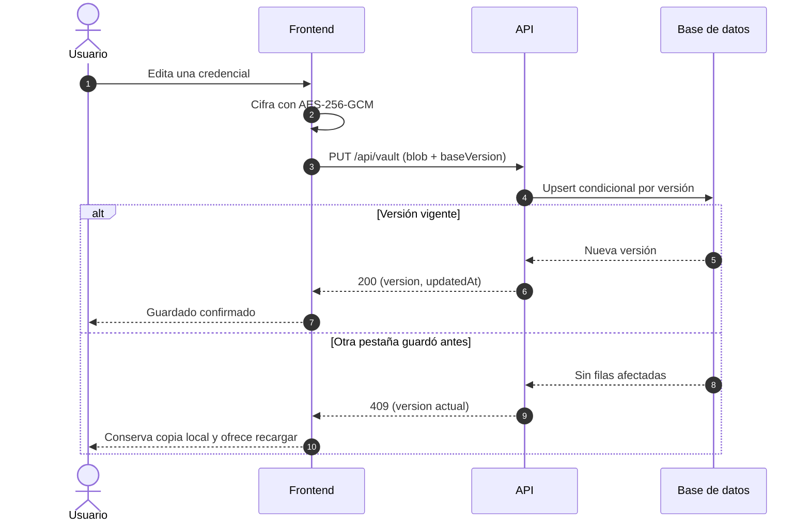

<div align="center">
  

  <br><br>

  [](#fases-1-y-2)
  [](#pruebas)
  [](#inicio-rápido)
  [](#stack)
  [](#seguridad)

  <p><strong>Tu bóveda de contraseñas, cifrada antes de salir del navegador.</strong><br>
  El servidor guarda un blob cifrado. La contraseña maestra nunca viaja.</p>

  [¿Qué es?](#qué-es-truquini) · [Arquitectura](#arquitectura) · [Inicio rápido](#inicio-rápido) · [Seguridad](#seguridad) · [API](#api) · [Despliegue](#despliegue)
</div>

---

> [!IMPORTANT]
> **Modelo zero-knowledge:** la contraseña maestra y la clave derivada viven solo en el navegador. El backend recibe `salt`, `iv`, `data` y metadatos públicos del KDF; nunca recibe el secreto.

## ¿Qué es truquini?

**truquini** es una bóveda personal de credenciales que cifra todo en el cliente con **AES-256-GCM** antes de enviarlo a la API. El backend es deliberadamente "ciego": almacena ciphertext y versiones, pero no puede leer tus contraseñas.

| Módulo | Qué resuelve |
|---|---|
| 🔐 **Cifrado en origen** | La contraseña maestra se usa en el navegador para derivar la clave; nunca se envía al servidor. |
| 🧬 **KDF versionado** | Bóvedas nuevas con PBKDF2 a 600.000 iteraciones; las antiguas se abren con sus parámetros y se migran al desbloquear. |
| 🕒 **Auto-bloqueo** | Tras 15 minutos de inactividad se limpian la clave, el DOM y los datos sensibles de la memoria. |
| ⚔️ **Sin sobrescrituras** | Cada guardado exige `baseVersion`. Si otra pestaña/dispositivo guardó antes, la API responde `409` y no pisa cambios. |
| 📦 **Autosave serializado** | Los guardados se encolan para que una respuesta lenta no reemplace una versión más nueva. |
| 🛡️ **Superficie mínima** | Helmet, CORS restringido, cookies `httpOnly`, rate limiting y `Cache-Control: no-store` en la API. |

## Stack

| Capa | Tecnologías |
|---|---|
| **Frontend** | HTML5, CSS3, JavaScript, Web Crypto API, D3.js |
| **Backend** | Node.js ≥ 20, Express 5, TypeScript 5.7 |
| **Datos** | Drizzle ORM + SQLite (local) / Neon Postgres (producción) |
| **Seguridad** | PBKDF2-HMAC-SHA256, AES-256-GCM, bcrypt, JWT, Helmet |
| **Despliegue** | Render + Neon, con el frontend servido por la misma API |

## Arquitectura



La frontera de confianza termina en el navegador. La contraseña maestra **no cruza** la conexión HTTPS: solo viaja el blob cifrado y la metadata necesaria para descifrarlo en el cliente.

### Flujo de guardado y conflictos



## Seguridad

| Capa | Implementación |
|---|---|
| **Cifrado** | AES-256-GCM en Web Crypto, con IV aleatorio por operación. |
| **Derivación** | PBKDF2-HMAC-SHA256: 600.000 iteraciones para bóvedas nuevas; 310.000 para el formato legado. |
| **Contraseña maestra** | Mínimo 12 caracteres y máximo 256; se limpia del DOM al desbloquear. |
| **Login** | bcrypt con coste 12; límite de 72 bytes; comparación dummy para usuarios inexistentes. |
| **Sesión** | JWT HS256 en cookie `httpOnly`, `Secure` en producción y `SameSite=Strict`. |
| **Concurrencia** | `baseVersion` obligatorio y upsert atómico; conflicto = `409` sin sobrescribir. |
| **Autosave** | Cola serializada y espera de guardados pendientes antes de bloquear. |
| **Cabeceras** | Helmet, CORS restringido a `FRONTEND_ORIGIN` y `no-store` en `/api` e `index.html`. |

> [!CAUTION]
> **No hay recuperación de contraseña maestra.** Si la pierdes, el blob cifrado no se puede descifrar. Guarda una copia segura de la contraseña y del archivo `.vault` exportado.

> [!WARNING]
> **Frontend y API deben compartir origen.** La cookie usa `SameSite=Strict`; si sirves el frontend desde otro dominio, la sesión no viajará. Para este proyecto, usa `vault-api/public/` servido por la misma API.

## Inicio rápido

### Requisitos

- **Node.js ≥ 20** y npm.
- Git.
- Opcional para producción: una base Neon Postgres.

### 1. Clona e instala

```bash
git clone https://github.com/cponce123com-create/truquini.git
cd truquini/vault-api
cp .env.example .env
npm install
```

En Windows puedes usar `Copy-Item .env.example .env`.

### 2. Configura el entorno

Genera un secreto para `JWT_SECRET`:

```bash
node -e "console.log(require('crypto').randomBytes(64).toString('hex'))"
```

Edita `vault-api/.env` y revisa, como mínimo:

```env
NODE_ENV=development
DB_TYPE=sqlite
JWT_SECRET=pega-aqui-el-secreto-generado
FRONTEND_ORIGIN=http://localhost:3000
TRUST_PROXY=1
PORT=3000
```

Para crear el primer usuario, pon temporalmente `ALLOW_REGISTRATION=true`. Después vuelve a `false` y reinicia la API.

### 3. Prepara la base y arranca

```bash
npm run db:push
npm run dev
```

Abre **http://localhost:3000**. La base SQLite local se crea en `vault-api/vault.db` y está ignorada por Git.

## API

| Método | Endpoint | Auth | Descripción |
|---|---|---|---|
| `POST` | `/api/auth/register` | — | Crea un usuario si `ALLOW_REGISTRATION=true`. |
| `POST` | `/api/auth/login` | — | Inicia sesión y establece la cookie `token`. |
| `POST` | `/api/auth/logout` | — | Limpia la cookie de sesión. |
| `GET` | `/api/auth/me` | 🔒 | Devuelve el usuario autenticado. |
| `GET` | `/api/vault` | 🔒 | Devuelve `{ salt, iv, data, kdf, version, updatedAt }` o `404`. |
| `PUT` | `/api/vault` | 🔒 | Crea o actualiza el blob cifrado. |
| `GET` | `/health` | — | Comprueba que la API está viva. |

`PUT /api/vault` requiere `baseVersion`:

```json
{
  "salt": "base64...",
  "iv": "base64...",
  "data": "base64...",
  "kdf": "{\"version\":2,\"name\":\"PBKDF2\",\"hash\":\"SHA-256\",\"iterations\":600000}",
  "baseVersion": 0
}
```

- `baseVersion: 0` crea una bóveda nueva.
- Si la versión no coincide, la API responde **409** con `{ error, version, updatedAt }` y **no modifica** el blob.
- `kdf` es metadata pública; las filas antiguas con `kdf = NULL` se interpretan como PBKDF2 legado.

## Estructura del proyecto

```text
truquini/
├── docs/
│   └── banner.svg              # Banner del README
├── vault-api/
│   ├── public/                 # Frontend canónico
│   │   ├── index.html
│   │   └── boveda.js
│   ├── src/
│   │   ├── db/                 # Esquema y conexión SQLite/Neon
│   │   ├── middleware/         # JWT y rate limiting
│   │   ├── routes/             # /api/auth y /api/vault
│   │   └── tests/              # Vitest + Supertest
│   ├── .env.example
│   ├── package.json
│   └── README.md
├── html5/                      # Versión legado: no desplegar
├── Otros/                      # Versión legado: no desplegar
├── CAMBIOS.md                  # Detalle técnico de las fases 1 y 2
└── README.md
```

## Fases 1 y 2

| Fase | Estado | Qué incluye |
|---|---|---|
| **Fase 1** | ✅ Completada | Contraseña maestra robusta, limpieza al bloquear, autosave serializado, correcciones XSS, upsert con versión y `trust proxy`. |
| **Fase 2** | ✅ Completada | Auto-bloqueo a los 15 minutos, KDF versionado con migración de bóvedas antiguas y resolución de conflictos con `409`. |

El detalle técnico está en **[CAMBIOS.md](CAMBIOS.md)**.

> [!TIP]
> La Fase 2 añade la columna nullable `kdf` en `vault_blobs`. Ejecuta `npm run db:push` **antes** de desplegar el backend nuevo.

## Pruebas

```bash
cd vault-api
npm test
npm run build
```

La suite cubre autenticación, carga y actualización de la bóveda, metadata KDF, conflictos `409`, `baseVersion` obligatorio y límites de payload.

| Comando | Resultado esperado |
|---|---|
| `npm test` | **19/19 tests** con Vitest + Supertest |
| `npm run build` | Compilación TypeScript sin errores |

## Despliegue

La combinación recomendada es **Render + Neon**, sirviendo el frontend desde la misma API.

1. Crea una base en [Neon](https://neon.tech) y copia el connection string.
2. Crea un **Web Service** en [Render](https://render.com) con:
   - **Root Directory:** `vault-api`
   - **Build Command:** `npm install && npm run build`
   - **Start Command:** `npm start`
3. Configura `NODE_ENV=production`, `DB_TYPE=neon`, `DATABASE_URL`, `JWT_SECRET`, `FRONTEND_ORIGIN` y `TRUST_PROXY=1`.
4. Desde tu máquina, con el `.env` apuntando a Neon, ejecuta `npm run db:push`.
5. Crea el usuario inicial con `ALLOW_REGISTRATION=true` y vuelve a `false` después.

> [!IMPORTANT]
> `npm run db:push` es un paso manual. No lo agregues al build de Render: `drizzle-kit push` puede modificar el esquema y no debe ejecutarse en cada deploy.

La guía detallada de variables, endpoints y despliegue está en **[vault-api/README.md](vault-api/README.md)**.

## Scripts

| Comando | Qué hace |
|---|---|
| `npm run dev` | Arranca la API con recarga en caliente (`tsx watch`). |
| `npm run build` | Compila TypeScript a `dist/`. |
| `npm start` | Ejecuta la API compilada. |
| `npm run db:push` | Sincroniza el esquema con la base de datos. |
| `npm run db:generate` | Genera migraciones de Drizzle. |
| `npm run db:migrate` | Aplica migraciones existentes. |
| `npm test` | Ejecuta la suite una vez. |
| `npm run test:watch` | Ejecuta la suite en modo watch. |

## Limitaciones

| Limitación | Detalle |
|---|---|
| **Sin recuperación** | No existe "olvidé mi contraseña". La bóveda no se puede descifrar sin la contraseña maestra. |
| **Pensado para un usuario** | El registro se desactiva después de crear la cuenta inicial; no es un servicio multiusuario. |
| **Mismo origen** | El frontend y la API deben compartir origen para que la cookie `SameSite=Strict` funcione. |
| **Carpetas legado** | `html5/` y `Otros/` no reciben los cambios de seguridad; no las uses para desplegar. |
| **Migración manual** | Los cambios de esquema requieren `npm run db:push` antes del despliegue. |

---

<div align="center">
  <sub>Hecho con foco en privacidad · truquini</sub>
</div>
